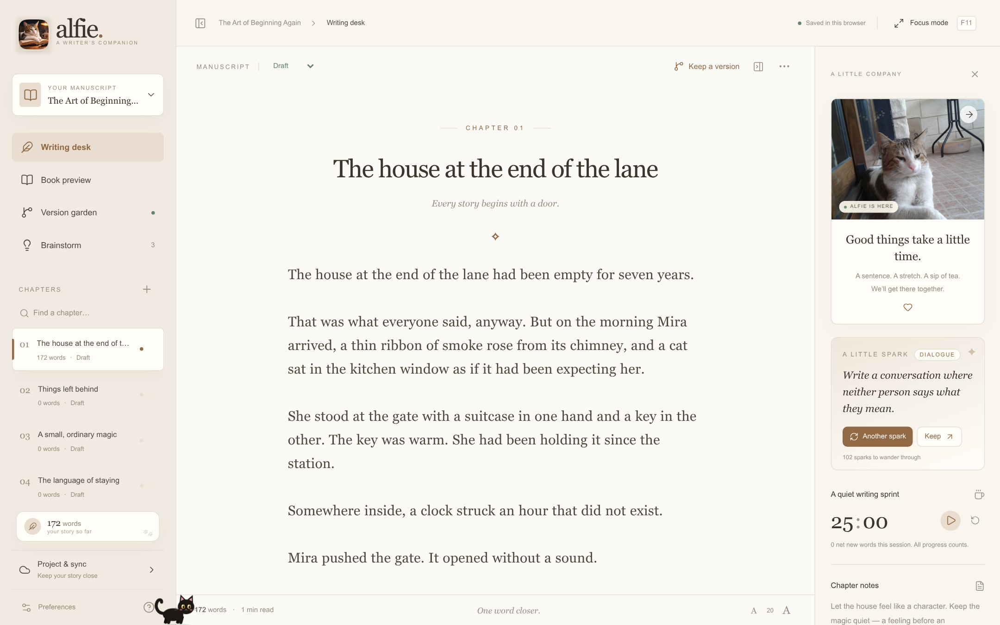
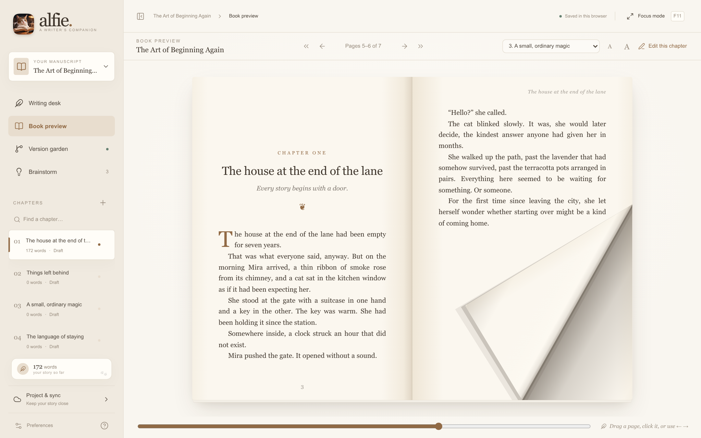
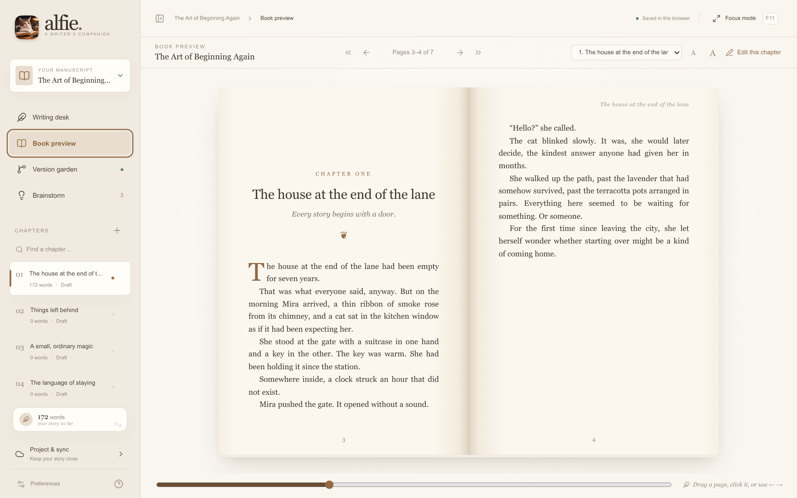
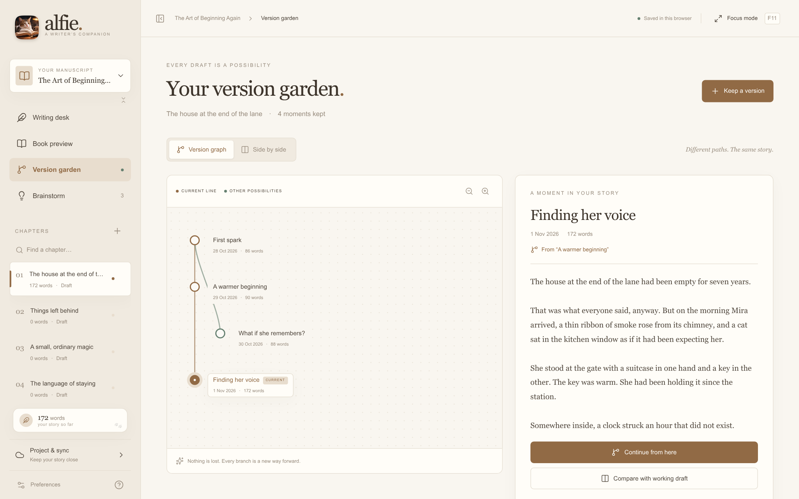
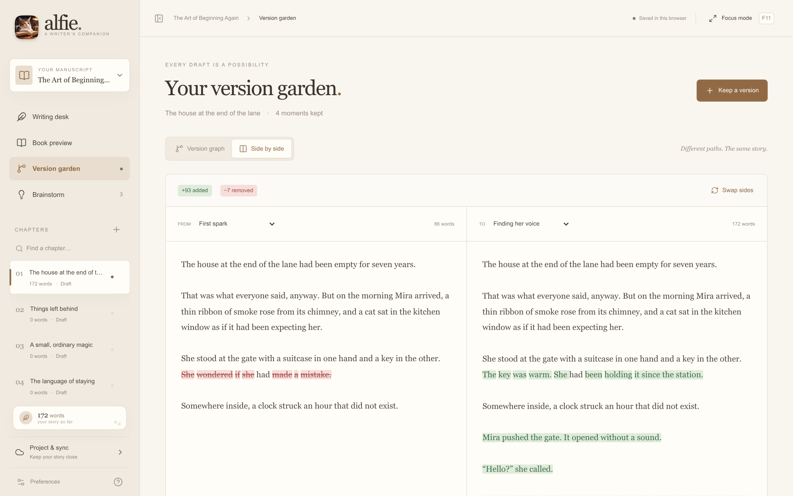
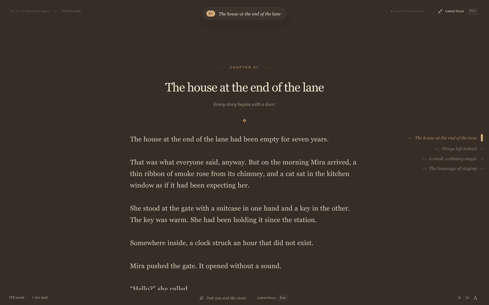
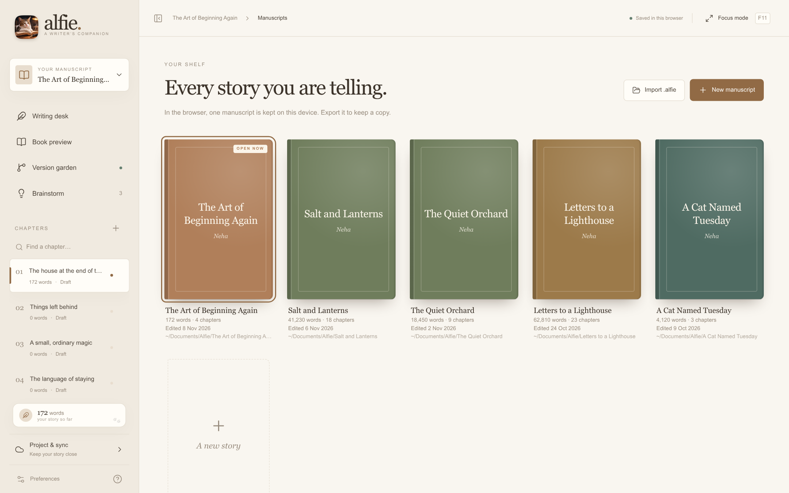

<p align="center"></p>

<h1 align="center">Alfie</h1>
<p align="center"><em>A little room for big stories.</em></p>

<p align="center">
  <a href="https://github.com/jwm3000/alfie/releases/latest"><strong>Download for Windows</strong></a> ·
  <a href="https://github.com/jwm3000/alfie/releases/latest">Linux (AppImage, .deb, .rpm)</a> ·
  <a href="#run-it-yourself">Run in the browser</a>
</p>

<p align="center"></p>

Alfie is a quiet, local-first writing studio. Write in chapters, keep named versions and branch from old ideas, turn the pages of your book as it grows, and sync each manuscript to your own GitHub repository. No account, no tracking, no cloud unless you ask for it. And a small black cat walks along the bottom of the screen when you click the logo.

## A book you can hold

<p align="center"></p>

The book preview sets your manuscript like a printed paperback: title page, contents, chapter openings with drop caps, running heads and page numbers. Grab a page anywhere and it folds after your pointer in every direction, like a real page. Let go and it settles on its own. Click, use the arrow keys or the slider to leaf through.

<p align="center"></p>

## Every draft is a possibility

<p align="center"></p>

Every named version becomes a point in the **version garden**. Continue from any earlier point to start a new branch without losing the current draft, then compare any two versions **side by side**: added words in green, removed words in red.

<p align="center"></p>

## Just you and the story

<p align="center"></p>

**Focus mode** (`F11`) hides everything but the page. Glide between chapters with `Alt ↑` / `Alt ↓` or the quiet chapter rail on the right. Choose **Light**, **Dark** or **Match system**, and pick a dark palette you like: warm *Walnut* or cool *Midnight*.

## All your manuscripts on one shelf

<p align="center"></p>

Each manuscript lives in its own folder in `Documents/Alfie`, and every chapter is also written as a Markdown file. Start a new story in one click, reopen recent ones from the project menu, and press **Sync with GitHub** to commit and sync in one step. Sync only ever fast-forwards: if both copies changed, Alfie stops and explains instead of discarding anything.

## Small comforts for long writing days

- **Chapters you can rearrange**: drag them in the sidebar; collapse the menu when you want to see more of them.
- **A little spark**: 102 writing prompts in nine moods. Keep the ones you like in your brainstorm.
- **Brainstorm board** for sparks, characters, places and questions, linked to chapters.
- **Writing sprints**, per-chapter notes, a word count for every chapter and the whole book.
- **Alfie**, the resident cat: three photos in the companion panel, and a walking, purring cat at the bottom of the screen.
- **Updates on their own**: Alfie checks GitHub for new versions and shows an *Update* button below the logo. One click saves your work, installs and restarts.

## Install

**Windows**: download `Alfie_…_x64-setup.exe` from the [latest release](https://github.com/jwm3000/alfie/releases/latest) and run it. No admin rights needed. Alfie isn't code-signed yet, so Windows may say *Windows protected your PC*: click **More info → Run anyway**.

**Linux**: use the AppImage (it updates itself), or the `.deb` / `.rpm` package from the same page. Tauri needs WebKitGTK 4.1, which most desktop distributions already have.

## Run it yourself

The web version runs in any modern browser and keeps one manuscript in local storage (export an `.alfie` backup to move it):

```sh
npm ci
npm run dev
```

For the desktop app, install Rust, Node 22, Git and the [Tauri v2 prerequisites](https://v2.tauri.app/start/prerequisites/), then:

```sh
cargo install tauri-cli --version '^2' --locked
npm ci
npm run desktop          # development
npm run desktop:build    # installers
```

## One honest, portable project

An `.alfie` file is readable UTF-8 JSON with a versioned schema: the book, every chapter, all version branches, brainstorm cards and your goal. In the desktop app each chapter is also saved as its own Markdown file:

```text
Documents/Alfie/My story/
├── .alfie                 # the complete project and version history
├── chapters/
│   ├── <id>-chapter-one.md
│   └── <id>-chapter-two.md
└── .git/                  # optional: sync with your own GitHub repository
```

Alfie saves atomically and checks that the project hasn't changed on disk before writing.

## Keyboard companions

| Key | Action |
| --- | --- |
| `Ctrl` / `⌘` + `S` | Save |
| `Ctrl` / `⌘` + `Shift` + `S` | Keep a named version of the chapter |
| `Ctrl` / `⌘` + `N` / `O` | New manuscript / open a manuscript |
| `Ctrl` / `⌘` + `B` | Show or hide the sidebar |
| `Alt` + `↑` / `↓` | Previous / next chapter |
| `F11` | Enter or leave focus mode |
| `←` `→` | Turn pages in the book preview |
| `Esc` | Leave focus mode or close a dialog |

## Releases

Pushing a tag `vX.Y.Z` builds the Windows installer and the Linux packages with GitHub Actions, signs them for the in-app updater and publishes the release. The signing key stays outside the repository (repository secrets `TAURI_SIGNING_PRIVATE_KEY` and `TAURI_SIGNING_PRIVATE_KEY_PASSWORD`).

---

<p align="center"><em>Made with love for Neha, by Norbert, and supervised by Alfie.</em></p>

MIT licensed. See [LICENSE](LICENSE).
